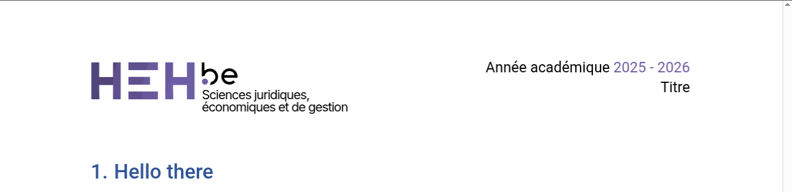
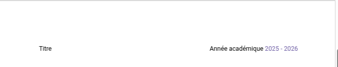

# Headers

## Liste des headers

- [Logo, année et titre](#logo-année-et-titre)
- [Année académique et titre](#année-académique-et-titre)

## Logo, année et titre



Affiche le logo a gauche et l'année académique / le titre à droite

```typst
header_style: headers.logo_year_title
```

### Paramètres `.with()`

- `bool show_year`: Affiche l'année acadamique (par défaut)
- `bool show_title`: Affiche le titre du document (par défaut)

## Année académique et titre



Affiche le titre et l'année académique (par défaut le titre à gauche et l'année à droite)

```typst
...
header_style: headers.year_title
...
```

### Paramètres (`.with()`)

- `bool title_left`: Affiche le titre à gauche (par défaut)
