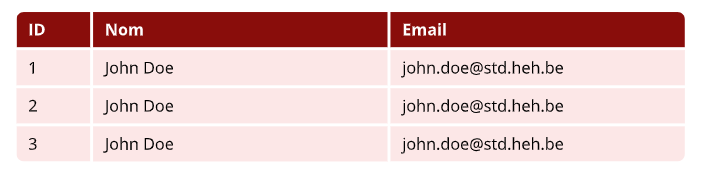
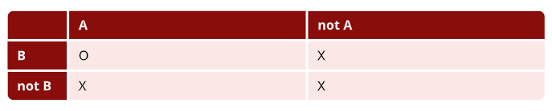
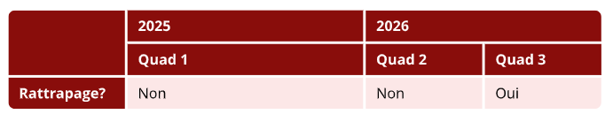

# Les Tableaux
Dans le heh-template, nous avons fait des tableaux en thème avec les couleurs des différents campus de la heh. le style est appliqué par défault si vous faites un simple tableau `#table()`.

Par exemple:
```typ
#table(
  columns: (50pt, 1fr, 1fr),
  table.header(
    [ID], [Nom], [Email]
  ),
  [1], [John Doe], [john.doe\@std.heh.be],
  [2], [John Doe], [john.doe\@std.heh.be],
  [3], [John Doe], [john.doe\@std.heh.be],
)
```


## Tableaux double entrées
Si vous voulez faire des tableaux a double entrées, vous pouvez importer directement `#double_table()` depuis heh-template

exemple:
```typ
#double_table(
  columns: (50pt, 1fr, 1fr),
  [], [A], [not A],
  [B], [O], [X],
  [not B], [X], [X]
)
```


## Tableaux Customs
Pour le moment, nous avons comme proposition que des tableaux simples et des tableaux a doubles entrées. Si vous souhaitez en faire avec un nombre x de headers ou encore faire d'autres choses avec vos tableaux, ça devient plus compliqué.

Pour vous aider, vous pouvez utiliser le state `campus_config_context` pour vous aider avec les couleurs de votre campus.

exemple de tableau custom:

```typ
#let custom_table(
  ..args
) = context {

    let primary_color = campus_config_context.get().style.primary_color

    show table.cell: it => {
    if(it.y <= 1 or it.x == 0) {
      set text(white, weight: "bold")
      it
    } else {
      it
    }
  }

  table(..args,     fill: (x, y) => {
    if (y <= 1 or x == 0) {
      primary_color.darken(40%)
    } else {
      primary_color.transparentize(90%)
    }
  })
}
```

Et son utilisation en pratique:
```typ
#custom_table(
  columns: (1fr, 1fr, 1fr, 1fr, 1fr),
  table.cell(rowspan: 2)[],
  table.cell(colspan: 2)[2025],
  table.cell(colspan: 2)[2026],
  table.cell(colspan: 2)[Quad 1],
  [Quad 2], [Quad 3],
  [Rattrapage?],
  table.cell(colspan: 2)[Non],
  [Non],
  [Oui]
)
```

Ce qui donne:

