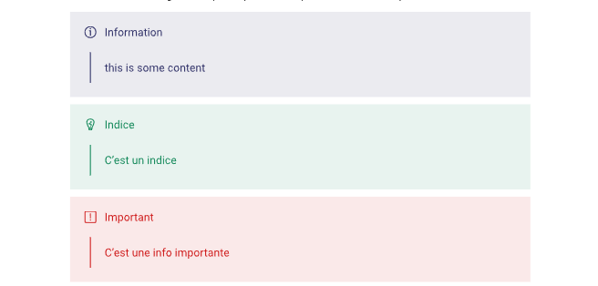

# Extras

Ces fonctionnalités ne sont pas présentes dans les templates HEH fournis par l'école, mais peuvent vous être utiles.

## Boites

Boites d'information, avertissement, d'astuces, ... pour mettre en évidence du texte



Pour les utilisez, importez les fonctions `info`, `important` ou `hint` depuis la template.

## Exemple

```
#import "@local/heh-template:1.0.0" : info, important, hint

#info[Information utile]
#hint[N'oubliez pas que vous pouvez entièrement customiser les boites d'information]
#important[N'oubliez pas de sauvegarder vos fichiers]
```

## Boite personalisée si vous le souhaitez

Il est très simple de créer une boite personalisée en modifiant les fonctions par défaut.

```typst
#let superimportant = important.with(
  accent_color: rgb("#8B0000"),
  title: "Super important !"
)

#superimportant[Attention, il faut impérativement penser à mettre à jour le tmeplate]
```

